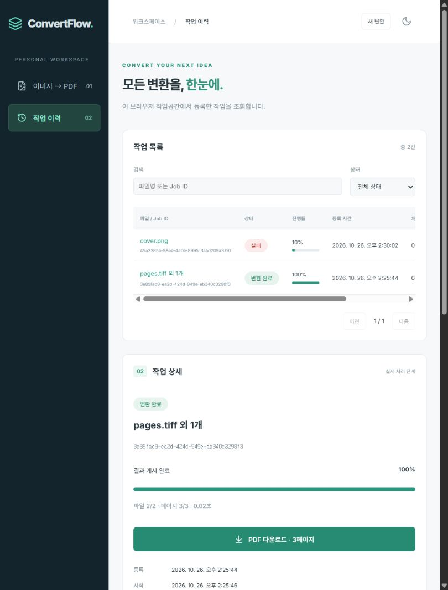

# ConvertFlow
이미지 업로드 요청과 PDF 변환을 분리하는 비동기 문서 처리 플랫폼입니다. **Phase 2 — 다중 파일 및 작업 관리**까지 구현하고 Docker에서 검증했습니다.

React → FastAPI → PostgreSQL Outbox → Dispatcher → Redis → Linux Celery Worker → 공유 스토리지로 처리합니다. DB를 상태의 기준으로 사용하고 큐에는 Job UUID만 전달합니다.

## 구현 기능
- PNG/JPEG/BMP/WEBP/TIFF 다중 업로드와 파일별 검증·제거·순서 변경
- 여러 이미지 및 TIFF 전체 페이지를 지정 순서대로 하나의 PDF로 변환
- 원본 크기 / A4 / Letter, 자동·세로·가로, 여백, 비율 유지 맞춤·중앙 자르기, JPEG 인코딩 품질
- 실제 처리 페이지 기반 진행률과 처리 단계, 입력 파일·옵션·결과 메타데이터
- 작업 목록·파일명/UUID 검색·상태 필터·페이지네이션·처리 시간
- 성공·실패 작업 상세와 영속 이벤트 타임라인, 검증한 PDF 다운로드
- 한국어 UI, Light/Dark 모드, 반응형 레이아웃

## 실행
Docker Desktop Linux 엔진을 실행하고 루트에서:
```bash
docker compose up -d --build --wait --wait-timeout 180
docker compose ps
```
[화면](http://localhost:8080) · [Swagger](http://localhost:8000/docs)
`.env.example`의 기본값으로 로컬 실행할 수 있습니다. 호스트 포트는 127.0.0.1에만 연결하며 DB·Redis는 내부 네트워크 전용입니다. Alembic migrate 서비스가 성공한 뒤 API와 Worker가 시작됩니다.

파일을 선택하거나 끌어다 놓고, 위·아래 버튼으로 순서를 바꿉니다. PDF 옵션을 지정한 뒤 변환합니다. TIFF는 각 프레임을 하나의 페이지로 확장합니다. 성공 후 PDF 다운로드를 누르세요. 작업 이력에서 검색하거나 상태를 필터링하고 파일명을 눌러 상세·이벤트를 확인할 수 있습니다.

제한은 파일 20개, 개별 20 MiB, 전체 100 MiB, 작업 전체 100페이지, 페이지당 25M 픽셀, 작업 전체 100M 픽셀입니다. 다중 프레임은 TIFF만 지원합니다. 원본 크기는 96 DPI 기준이며 자동 방향은 원본 크기에서는 원본 비율, A4/Letter에서는 기본 세로입니다. 원본이 작으면 큰 여백은 실패할 수 있으며 오류 원인을 이력에 보존합니다.

## 작업공간 및 기존 데이터
첫 정상 업로드에서 30일 HttpOnly/SameSite=Lax 쿠키로 로컬 브라우저 작업공간을 만듭니다. 서버는 해시만 저장하고 목록·상세·다운로드를 해당 작업공간으로 제한합니다. 기존 `X-Job-Token` 단일 작업 접근 방식도 유지합니다. 쿠키를 삭제하면 목록 접근 권한이 사라집니다. 이는 사용자 계정 인증을 대신하지 않으며 공개 서비스용이 아닙니다.

0002 마이그레이션은 기존 작업·오류·결과를 보존하고 파일·결과 테이블을 채웁니다. 소유자를 알 수 없는 Phase 1 작업은 임의의 브라우저 목록에 노출하지 않습니다. 기존 접근 토큰으로 계속 조회·다운로드할 수 있습니다. 과거 이벤트를 추측해 만들지 않고 `LEGACY_IMPORTED` 스냅샷만 추가합니다. 다중 파일/이력 유실 방지를 위해 0002 downgrade는 의도적으로 차단합니다.

## 검증
Python 3.12, Node 22 이상을 권장합니다.
```bash
python -m venv .venv
# venv 활성화 후
pip install -r backend/requirements.lock.txt
cd backend
python -m pytest -q
ruff check .
cd ../frontend
npm ci
npm test
npm run lint
npm run build
```
Compose 기동 후 루트에서:
```bash
python scripts/smoke.py
python scripts/smoke_phase2.py
docker compose exec -T api alembic check
docker compose logs -f api worker dispatcher
```
백엔드 **Windows·Linux 각각 42개 테스트**, 프런트 **4개 테스트·타입 검사·빌드**가 통과했습니다. 실제 Redis→Linux Worker로 단일 이미지 및 3페이지 TIFF 병합, 출력 크기·순서, 실패 이벤트, 작업공간 격리를 확인했습니다. 브라우저에서도 순서 변경→A4 가로 변환→다운로드한 PDF 검증과 실패 필터를 확인했습니다. 원격 GitHub Actions는 정의만 갱신했고 실행하지 않았습니다. 자세한 결과는 [진행 현황](docs/PROGRESS.md)을 확인하세요.

## 설계와 남은 범위
조건부 DB Claim과 Job별 고유 Result, 상태 갱신과 동일 트랜잭션의 완료 이벤트로 중복 반영을 방지합니다. 임시 PDF를 전체 검증한 뒤 동일 볼륨에서 원자 이동하며 SUCCESS 결과만 다운로드합니다. DB와 파일시스템 사이 원자성을 보장하지는 않습니다.

**다음 Phase 3:** 오류 분류 정비, 자동·수동 재시도, Attempt 이력, Retry Center, 취소. 현재 실패 이벤트는 보존하지만 재시도 기능은 제공하지 않습니다. Worker 강제 종료 후 PROCESSING 복구, Lease/Fencing, 다중 Worker 장애 검증은 Phase 4입니다. 자동 만료·청소, 사용자 인증, 모니터링, 성능 벤치마크도 아직 없습니다.

```bash
docker compose down  # 종료, 볼륨 데이터 보존
```
스택: React 19.1 / TypeScript 5.8 / Vite 6.4 / TanStack Query / Axios / Lucide / Vitest, Python 3.12 / FastAPI / SQLAlchemy / Alembic / psycopg / Celery / Redis / Pillow / pypdf, PostgreSQL 16.9 / Redis 7.4.4 / Nginx. 의존성은 기존 lockfile을 유지했으며 새 라이브러리는 추가하지 않았습니다. UI는 현재 단일 콘솔 내 업로드·이력 전환을 사용합니다.



[전체 요구사항](PROJECT.md) · [진행 현황](docs/PROGRESS.md) · [아키텍처](docs/ARCHITECTURE.md) · [ADR](docs/DECISIONS.md) · [API](docs/API.md) · [검증 절차](docs/TEST-SCENARIOS.md)
