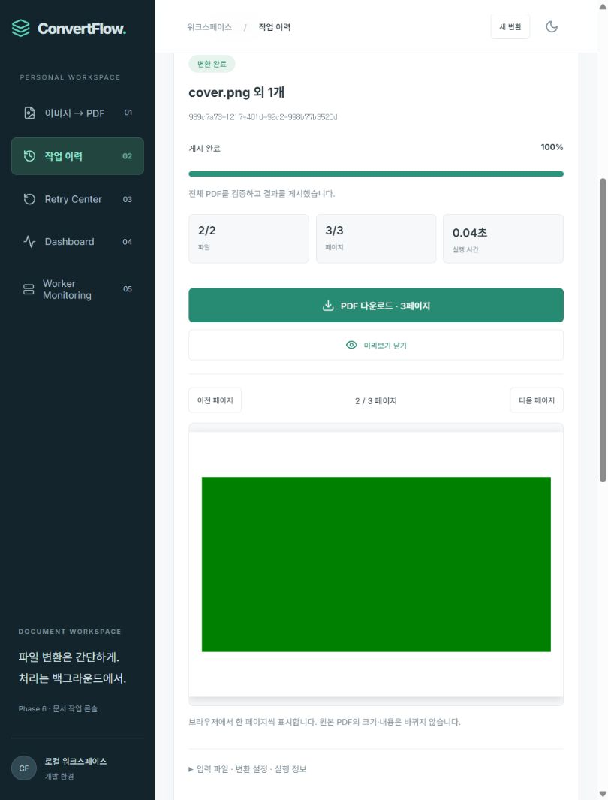

# ConvertFlow
이미지 업로드 요청과 PDF 변환을 분리하는 비동기 문서 처리 플랫폼입니다. **Phase 6 — UI/UX 개선**까지 구현했습니다. 실제 실행 결과는 [진행 현황](docs/PROGRESS.md)에 기록합니다.

React → FastAPI → PostgreSQL Outbox → Dispatcher → Redis → Linux Celery Worker → 공유 스토리지로 처리합니다. DB를 상태의 기준으로 사용하고 큐에는 Job UUID와 실행 세대만 전달합니다.

## 구현 기능
- PNG/JPEG/BMP/WEBP/TIFF 다중 업로드와 파일별 검증·제거·순서 변경
- 여러 이미지 및 TIFF 전체 페이지를 지정 순서대로 하나의 PDF로 변환
- 원본 크기 / A4 / Letter, 자동·세로·가로, 여백, 비율 유지 맞춤·중앙 자르기, JPEG 인코딩 품질
- 실제 처리 페이지 기반 진행률과 처리 단계, 입력 파일·옵션·결과 메타데이터
- 작업 목록·파일명/UUID 검색·상태 필터·페이지네이션·처리 시간
- 성공·실패 작업 상세와 영속 이벤트 타임라인, 검증한 PDF 다운로드
- 같은 Job 아래 실행별 Attempt와 오류·Worker·시간·재시도 이력 보존
- 일시 오류 자동 재시도: 최대 3회, 지수 backoff + jitter, DB 기반 실행 예약
- Retry Center의 실패 작업 조회·수동 재처리·불가 사유 표시
- 대기/재시도 대기 즉시 취소, 실행 중 협조적 취소와 결과 게시 차단
- DB 시각 기반 Lease·독립 Heartbeat, 만료 실행 회수·새 Attempt 복구·오래된 Worker fencing
- 미획득 메시지 재발행, Worker 중단·재시작 및 DB/Redis 복귀 후 작업 재개
- Dashboard의 작업 상태 분포, 최근 처리시간·성공 처리량·실패 Attempt 코드 통계
- 별도 Observer의 실제 Worker 응답·활성 작업·큐 수집, 관측 시각과 UNKNOWN 표시
- RGB 변환 복사 감소와 스트리밍 checksum, 복합 DB 인덱스 및 실제 부하 측정
- 한국어 UI, Light/Dark 모드, 반응형 레이아웃
- 인증된 실제 PDF의 페이지별 Canvas 미리보기, 페이지 전환·닫기·재열기
- 업로드 썸네일·오류 파일 제거·빈 파일 검사, 실제 전송/변환 진행률 구분
- 고정 내비게이션·선택 Job 상세 이동, 모바일 작업 카드·화면 선택, 테마 저장
- 최신 이벤트 30개부터 더 보기, 오류·재시도·취소 필터와 원인별 안내

## 실행
Docker Desktop Linux 엔진을 실행하고 루트에서:
```bash
docker compose up -d --build --wait --wait-timeout 180
docker compose ps
```
[화면](http://localhost:8080) · [Swagger](http://localhost:8000/docs)
`.env.example`의 기본값으로 로컬 실행할 수 있습니다. 호스트 포트는 127.0.0.1에만 연결하며 DB·Redis는 내부 네트워크 전용입니다. Alembic migrate 서비스가 성공한 뒤 API와 Worker가 시작됩니다.

파일을 선택하거나 끌어다 놓고, 위·아래 버튼으로 순서를 바꿉니다. PDF 옵션을 지정한 뒤 변환합니다. TIFF는 각 프레임을 하나의 페이지로 확장합니다. 성공 후 PDF 다운로드를 누르세요. 작업 이력에서 검색하거나 상태를 필터링하고 파일명을 눌러 상세·이벤트를 확인할 수 있습니다.

제한은 파일 20개, 개별 20 MiB, 전체 100 MiB, 작업 전체 100페이지, 페이지당 25M 픽셀, 작업 전체 100M 픽셀입니다. 다중 프레임은 TIFF만 지원합니다. 원본 크기는 96 DPI 기준이며 자동 방향은 원본 크기에서는 원본 비율, A4/Letter에서는 기본 세로입니다. 원본이 작으면 큰 여백은 실패할 수 있으며 오류 원인을 이력에 보존합니다.

성공 후 **결과 미리보기**를 열면 PDF.js가 같은 결과를 브라우저에서 렌더링합니다. 다음/이전 페이지로 이동하고 닫을 수 있습니다. 미리보기는 확인된 32 MiB 이하 결과에 제공하며 한 페이지 Canvas를 약 2M pixels로 제한합니다. 원본 PDF는 바뀌지 않고 큰 파일·지원되지 않는 브라우저는 다운로드를 이용합니다. PDF 엔진은 로컬 asset으로 제공하며 외부 서비스에 문서를 보내지 않습니다.

전송 100%는 변환 완료가 아닙니다. API 검증과 Worker의 실제 파일/페이지 처리·결과 검증 상태를 별도로 확인하세요. 작업 이력에서 파일명을 누르면 상세로 이동하고, 최신 이벤트에서 **더 보기**로 과거 이력을 읽습니다. 테마는 브라우저에 저장되며 파일 선택은 새로고침 뒤 보존하지 않습니다.

## 재시도와 취소
일시적 저장소 오류·리소스 부족·soft time limit은 최초 실행 이후 최대 3회 자동 재시도합니다. 기본 대기 범위는 1차 2.5~5초, 2차 5~10초, 3차 10~20초이며 최대 지연 설정은 300초입니다. DB의 예약 시각이 지나면 Dispatcher가 QUEUED 전환을 먼저 커밋하고 실행 세대를 포함한 메시지를 발행합니다. 브로커에 미래 ETA 메시지를 장기 보관하지 않습니다.

최대 횟수 초과나 일반 변환 실패는 Retry Center에서 원인을 확인한 후 **같은 파일로 재시도**할 수 있습니다. 원본·옵션·Job ID를 유지하고 새 Attempt를 추가하며 이전 오류를 지우지 않습니다. 수동 재시도는 자동 재시도 주기를 새로 시작합니다. 손상된 입력·미지원 형식·잘못된 옵션은 같은 입력으로 재시도하지 않습니다. 원본이 없거나 변경되면 요청을 거부합니다. 권한 오류는 자동 반복하지 않으며 운영자가 권한을 복구한 뒤 수동 재시도할 수 있습니다.

**작업 취소**를 누르면 QUEUED/RETRY_WAIT는 즉시 CANCELLED, PROCESSING은 CANCEL_REQUESTED가 됩니다. Worker는 입력 파일/페이지 처리 경계와 결과 게시 직전 취소를 확인합니다. 이미지 디코딩·인코딩을 즉시 강제 종료하지는 않습니다. 취소가 확정되면 결과를 다운로드할 수 없습니다. 이미 SUCCESS로 확정된 작업은 취소할 수 없습니다. Worker가 사라진 취소 요청은 Lease 만료 후 스케줄러가 소유권을 회수하고 CANCELLED로 확정합니다.

## Worker 장애 복구
기본 Lease는 30초, 독립 Heartbeat는 5초입니다. `LEASE_SECONDS`, `HEARTBEAT_SECONDS`, `REDISPATCH_SECONDS`를 `.env`에서 조정할 수 있으며 Heartbeat 간격은 Lease의 절반 미만이어야 합니다. Dispatcher는 3초마다 만료 소유권을 회수하고 `WORKER_LEASE_EXPIRED` 오류를 이전 Attempt에 보존합니다. 기존 자동 재시도 상한과 backoff를 적용해 새 세대를 예약합니다. DB가 없으면 상태 변경을 중단하고 DB 복귀 후 회수합니다. 발행됐지만 30초 동안 Claim되지 않은 메시지도 재발행합니다.

오래된 Worker는 Lease·세대·Attempt 검사를 통과해야 진행/결과를 반영할 수 있습니다. 긴 네이티브 연산이 겹쳐 실행될 수 있지만 최종 Result와 완료 이벤트는 하나입니다. 파일 이동 직후 DB 커밋 전에 죽으면 이전 Attempt의 비공개 orphan PDF가 남을 수 있습니다. 자동 청소는 아직 없습니다. 배포 시 구버전 Worker를 drain/중지하고 API·Worker·Dispatcher를 함께 교체하세요.

## 작업공간 및 기존 데이터
첫 정상 업로드에서 30일 HttpOnly/SameSite=Lax 쿠키로 로컬 브라우저 작업공간을 만듭니다. 서버는 해시만 저장하고 목록·상세·다운로드를 해당 작업공간으로 제한합니다. 기존 `X-Job-Token` 단일 작업 접근 방식도 유지합니다. 쿠키를 삭제하면 목록 접근 권한이 사라집니다. 이는 사용자 계정 인증을 대신하지 않으며 공개 서비스용이 아닙니다.

0002 마이그레이션은 기존 작업·오류·결과를 보존하고 파일·결과 테이블을 채웁니다. 소유자를 알 수 없는 Phase 1 작업은 임의의 브라우저 목록에 노출하지 않습니다. 기존 접근 토큰으로 계속 조회·다운로드할 수 있습니다. 과거 이벤트를 추측해 만들지 않고 `LEGACY_IMPORTED` 스냅샷만 추가합니다. 다중 파일/이력 유실 방지를 위해 0002 downgrade는 의도적으로 차단합니다. 0003은 이전 실행을 LEGACY Attempt로 보존하며 알 수 없는 Worker는 UNKNOWN, 없는 시각은 null로 남깁니다. Attempt 이력을 잃는 0003 downgrade도 차단합니다.

0004는 Lease, 0005는 관측 테이블·조회 인덱스를 추가하며 이전 Job/Attempt/결과·오류를 유지합니다. 현재 스키마는 0005입니다.

## Dashboard와 Worker Monitoring
왼쪽 메뉴의 Dashboard에서 이 브라우저 작업공간의 상태 분포와 최근 60분 통계를 확인합니다. 평균 실행 시간은 마지막 성공 실행의 시작→완료, 접수→성공 평균은 대기·재시도까지 포함합니다. 시간 표본이 없으면 `—`이며, 과거 실패는 재시도 성공 후에도 Attempt 오류 통계에 남습니다.

Observer가 Celery Inspect와 기본 celery 큐를 수집해 PostgreSQL에 저장하고 API는 캐시를 조회합니다. 수집 주기는 기본 10초 대기에 네트워크 요청 시간이 더해지며 화면은 5초마다 조회합니다. 30초 이상 오래되거나 응답을 확인하지 못하면 `UNKNOWN`입니다. 이는 Worker 종료 판정이 아닙니다. 마지막 응답·수집 시각을 표시하며 모르는 값을 0으로 만들지 않습니다.

Worker 이름·슬롯·활성 Task 수·큐 ready 메시지는 **전체 인프라** 값입니다. 활성 Job ID와 최근 성공/실패는 이 작업공간만 표시합니다. 큐 수치는 예약/실행/Job 수와 다릅니다. 운영자 인증이 없는 localhost 개발용 모니터링이며 공개 운영 권한 체계는 아직 없습니다.

Worker 확장과 복원:
```bash
docker compose up -d --scale worker=2 worker
docker compose up -d --scale worker=1 worker
```
컨테이너당 concurrency 1·CPU 1·768 MiB입니다. 실제 6 Job 부하에서 두 Worker가 각각 3개를 처리했지만, 작은 입력의 전체 시간은 1개 2.37초/2개 3.37초여서 확장이 항상 빠르지는 않았습니다. 기본값은 1개를 유지합니다.

같은 Linux 새 프로세스에서 8페이지 2048² RGB TIFF를 각 3회 비교했을 때 변환 peak 메모리 중앙값은 **163.6→115.4 MiB**, 64 MiB 파일 해시는 **110.2→46.3 MiB**였습니다. PDF 페이지·이미지 해시와 파일 checksum이 일치했습니다. 합성 데이터의 한 환경 측정이며 일반적인 성능 보장은 아닙니다. [측정 방법과 원본 결과](docs/benchmarks/README.md)를 확인하세요.

## 검증
Python 3.12, Node 22.13 이상 또는 24 이상을 사용합니다.
```bash
python -m venv .venv
# venv 활성화 후
pip install -r backend/requirements.lock.txt
cd backend
python -m pytest -q
ruff check .
cd ../frontend
npm ci
npm test
npm run lint
npm run build
```
Compose 기동 후 루트에서:
```bash
python scripts/smoke.py
python scripts/smoke_phase2.py
docker compose exec -T api alembic check
docker compose logs -f api worker dispatcher
```
백엔드 **Windows·Linux 각각 82개 테스트**, 프런트 **15개 테스트·타입 검사·빌드**가 통과했습니다. 실제 32페이지 PDF·36개 이벤트의 역방향 커서/기존 API·권한을 검증했습니다. 브라우저에서는 오류 파일 제거·순서 변경→A4 가로 3페이지 변환→실제 PDF 페이지 렌더링/전환·테마 저장, 대기 취소·저장소 오류 후 수동 재시도와 Attempt 보존, 모듈 로드 실패의 콘솔 격리·복귀를 확인했습니다. 390px iframe에서 모바일 카드·필터·상세 이동·미리보기도 확인했으며 실제 모바일 기기/Safari 테스트는 아닙니다. 이전 Phase 5의 부하·메모리 결과도 보존합니다. 원격 GitHub Actions는 정의만 갱신했고 실행하지 않았습니다. 자세한 결과는 [진행 현황](docs/PROGRESS.md)을 확인하세요.

실제 Phase 3 장애 주입 테스트는 일반 Dispatcher를 잠시 중지한 전용 테스트 프로세스에서만 실행합니다. 운영 코드에 오류 주입 플래그는 없습니다. 실행·복원 방법은 [검증 절차](docs/TEST-SCENARIOS.md)를 확인하세요.

## 설계와 남은 범위
조건부 DB Claim과 Job별 고유 Result, 상태 갱신과 동일 트랜잭션의 완료 이벤트로 중복 반영을 방지합니다. 임시 PDF를 전체 검증한 뒤 동일 볼륨에서 원자 이동하며 SUCCESS 결과만 다운로드합니다. DB와 파일시스템 사이 원자성을 보장하지는 않습니다.

**다음 Phase 7:** 자동화 테스트·E2E·장애 시나리오와 포트폴리오 정리입니다. 자동 파일 만료·청소, 사용자 계정 인증, 요청 Idempotency-Key, 장기 soak·누수 및 실사용 파일 성능 평가는 아직 없습니다. 파일을 새로 업로드하면 별도 Job입니다. 장애 시 즉시 복구를 보장하지 않으며 DB·스토리지가 사용 가능하고 Dispatcher가 돌아야 합니다.

```bash
docker compose down  # 종료, 볼륨 데이터 보존
```
스택: React 19.1 / TypeScript 5.8 / Vite 6.4 / TanStack Query / Axios / PDF.js 6.4.299 / Lucide / Vitest, Python 3.12 / FastAPI / SQLAlchemy / Alembic / psycopg / Celery / Redis / Pillow / pypdf, PostgreSQL 16.9 / Redis 7.4.4 / Nginx. PDF.js만 추가하고 package-lock에 고정했으며 npm audit는 검사 시점 알려진 취약점 0건이었습니다. UI는 단일 콘솔 내 화면 전환을 사용합니다.


[모바일 미리보기](docs/screenshots/phase6-mobile-preview.png) · [모바일 이력](docs/screenshots/phase6-mobile-history.png) · [이전 Dashboard](docs/screenshots/phase5-dashboard.png)

[전체 요구사항](PROJECT.md) · [진행 현황](docs/PROGRESS.md) · [아키텍처](docs/ARCHITECTURE.md) · [ADR](docs/DECISIONS.md) · [API](docs/API.md) · [검증 절차](docs/TEST-SCENARIOS.md)
