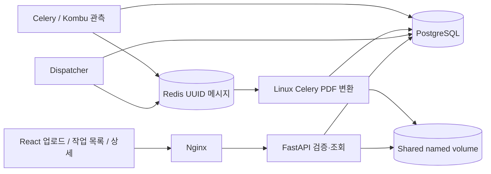
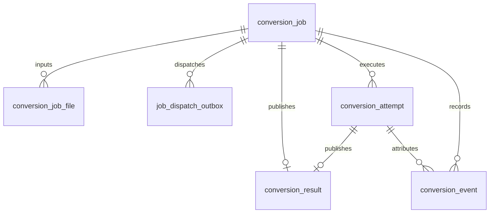

# 시스템 아키텍처 — Phase 7

## 파일 처리 흐름
1. 브라우저가 다중 파일의 순서와 검증된 형식의 options JSON을 multipart로 전송한다.
2. API가 UUID 경로에 저장하면서 개별/전체 크기를 제한하고, 모든 프레임을 디코딩해 실제 포맷·MIME·픽셀·페이지 제한을 확인한다.
3. Job, JobFile(0 기반 sort_order), Outbox, QUEUED 이벤트를 같은 DB 트랜잭션으로 저장한다. 하나라도 실패하면 이번 업로드 파일을 정리한다.
4. Dispatcher는 만료 Lease/미획득 메시지를 회수하고 미발행 Outbox의 UUID·실행 세대를 Redis에 발행한다. 발행 후 DB commit 실패에 따른 중복 전달을 허용한다.
5. Worker는 같은 세대 QUEUED→PROCESSING 조건부 Claim에 성공한 경우만 실행한다. Attempt·Lease를 설정하고 독립 Heartbeat를 시작한다. 원본 해시와 페이지 정보를 다시 검증한다.
6. 파일 순서대로 TIFF 프레임을 확장한다. EXIF 방향·alpha 합성 후 Pillow PDF 페이지를 인코딩하고 pypdf로 크기·여백·fit을 적용한다. 디코딩한 전체 이미지 목록을 메모리에 쌓지 않는다. 인코딩된 PDF 객체는 Writer가 보관하므로 완전한 streaming 변환은 아니다.
7. 페이지 완료마다 Job 진행률과 PAGE_PROCESSED 이벤트를 한 트랜잭션으로 기록한다. 최종 페이지 수·PDF 파싱 검증 후 결과를 원자 이동한다.
8. Job row lock을 유지하며 Result(고유 job_id), SUCCESS 상태, 완료 이벤트를 같은 트랜잭션으로 확정한다. 실패 시 현재 진행 수를 남기고 FAILED 이벤트를 추가하며 부분 PDF를 다운로드하지 않는다.
9. UI는 상세·이벤트를 polling하고 종료 상태에서 멈춘다. 목록은 표시 중 주기적으로 조회한다. 다운로드 시 권한·SUCCESS·결과 크기·해시를 검사한다.

## DB ERD

Job: UUID, workspace/access 해시, 상태, 단계, options JSON, 전체/완료 파일·페이지 수, UTC 시간, 오류 코드·메시지, run_generation, active_attempt_id, attempt_count, auto_retry_count, next_retry_at, heartbeat_at, lease_expires_at(index).
Attempt: UUID, Job FK, (job_id,attempt_number) 및 (job_id,generation) 고유 제약, origin·Worker·상태·시작/종료·오류·retryable. Result와 Event는 해당 Attempt FK로 귀속한다. Outbox는 (job_id,generation) 고유 제약과 available_at 시각을 갖는다.
JobFile: UUID, FK, 파일명, UUID 저장 경로, 크기·MIME·페이지·SHA256, sort_order. (job_id,sort_order) 고유 제약.
Result: UUID, 고유 Job FK, 경로·크기·SHA256·페이지 수·UTC 시간.
Event: UUID, Job FK, (job_id,sequence) 고유 제약, 타입·메시지·JSON details·UTC 시간. Job 갱신 lock 안에서 sequence를 부여하며 이력은 append-only다.
Job의 workspace_hash+created_at 복합 인덱스와 상태/각 FK 조회 인덱스를 사용한다. 구형 Job 입력·출력 컬럼은 호환성을 위해 유지하되 신규 파일/결과의 기준은 분리 테이블이다.

0002는 구형 단일 파일과 성공 결과를 backfill한다. 구형 오류를 그대로 보존하며 단계별 과거 이벤트를 만들어내지 않는다. LEGACY_IMPORTED 스냅샷만 추가한다. 데이터 유실이 생기는 downgrade는 차단했다.

## 상태와 진행률
현재 상태: QUEUED → PROCESSING → SUCCESS | FAILED | RETRY_WAIT. RETRY_WAIT→QUEUED, FAILED→QUEUED(수동 새 세대). QUEUED/RETRY_WAIT→CANCELLED, PROCESSING→CANCEL_REQUESTED→CANCELLED. UPLOADING은 프런트 전용이다.
단계: QUEUED(0), INPUT_VALIDATION(10), PAGE_PROCESSING(10+floor(75×완료 페이지/전체 페이지)), RESULT_VALIDATION(95), SUCCESS(100). 전체 파일 수와 페이지 수를 별도로 추적한다. 성공 결과가 검증·게시·DB 확정되기 전에는 100을 기록하지 않는다.

## 권한 경계
신규 작업은 무작위 작업공간 capability 쿠키의 해시로 소유 범위를 제한한다. 목록은 해당 cookie 소유 작업만, 상세·이벤트·다운로드는 소유 cookie 또는 개별 Job 토큰을 확인한다. 기존 소유자를 모르는 Phase 1 작업은 목록에 자동 편입하지 않는다. 로컬 단일 사용자 MVP이며 계정 인증·다중 테넌트 서비스가 아니다.

## 중복 처리와 한계
원자적 Claim은 QUEUED와 전달된 실행 세대가 일치할 때만 성공한다. Claim과 Attempt 생성은 같은 트랜잭션이다. 페이지 진행/종료 갱신은 현재 세대와 active_attempt_id가 일치해야 한다. 수동 재시도는 FAILED 및 expectedGeneration으로 CAS 갱신하고 새 세대를 생성한다. 성공 결과와 완료 이벤트는 동일 트랜잭션으로 한 번만 확정한다. 결과 경로에도 Attempt UUID를 넣어 다른 시도의 파일과 충돌하지 않는다.

자동 재시도는 실패 Attempt를 종료하고 새 세대 Outbox + available_at + RETRY_WAIT를 한 트랜잭션으로 저장한다. Dispatcher는 ① 예약 도래 Job의 QUEUED 전환을 먼저 커밋하고 ② 별도 트랜잭션에서 Outbox를 잠그고 발행한다. 발행 전에 QUEUED가 다른 DB 연결에도 보여야 한다. 그렇지 않으면 즉시 소비한 Worker가 아직 RETRY_WAIT인 행을 건너뛰는 경합이 발생한다. 새로 도래하여 아직 RETRY_WAIT인 Outbox는 다음 준비 주기까지 발행하지 않는다. Redis 장애는 미발행 Outbox에 남겨 재시도한다. 발행 후 DB commit 실패에 따른 중복 메시지는 세대/Claim으로 막는다.

취소는 DB 상태 변경이며 프로세스를 강제 종료하지 않는다. Worker가 입력 파일·페이지 경계와 최종 게시 전에 취소를 확인하고 Attempt 종료와 CANCELLED 이벤트를 함께 기록한다. 게시 직전 Job row lock으로 취소/성공 확정을 직렬화한다. 취소 요청이 먼저 확정되면 결과를 공개하지 않고, SUCCESS가 먼저 커밋되면 뒤의 취소 요청은 409다.

Phase 4는 Job의 heartbeat_at/lease_expires_at을 DB 시각으로 관리한다. Claim과 Heartbeat는 row lock 획득 후 시각을 읽는다. 별도 Heartbeat thread가 인코딩 중에도 갱신하며 모든 진행/게시/실패는 미만료 Lease+세대+Attempt 소유권을 확인한다. Dispatcher는 SKIP LOCKED로 만료 실행을 회수하고 이전 Attempt 오류·새 세대 Outbox를 함께 커밋한다. 취소 요청은 재실행하지 않는다. 아직 Claim되지 않은 발행 메시지는 30초 후 재발행한다. 오래된 프로세스의 CPU 연산 자체를 막지는 않지만 결과 확정은 차단한다. DB/파일시스템 원자 커밋과 orphan 자동 정리는 없다.

공유 저장소는 uploads/{job}/UUID, processing/{job}/{execution UUID}/output.pdf, results/{job}/{attempt UUID}.pdf 구조다. 실행별 임시 경로와 전체 결과 검증을 유지한다. 자동 만료·용량 정리는 미구현이다. Redis/DB/Worker 모니터링 수치를 임의로 만들지 않는다.

## 이전 데이터 및 테스트 경계
0003은 기존 성공/실패/실행 중 Job을 LEGACY Attempt 하나로 보존하고 결과에 연결한다. 과거 Worker나 누락된 시간을 추정하지 않는다. 기존 이벤트는 원문을 유지하며 과거 Attempt 귀속을 임의로 채우지 않는다. 0004는 기존 데이터에 nullable Lease 컬럼만 추가한다. 구버전 Worker는 fencing을 모르므로 배포 전에 drain/중지하고 함께 교체해야 한다. Phase 4 Worker의 비정상 종료와 재시작 복구는 지원한다.

제품의 변환은 별도 Celery Worker가 수행한다. 장애 주입 테스트에서만 API 컨테이너의 별도 테스트 프로세스에 Celery solo test worker와 전용 큐를 사용하며 실제 Redis/PostgreSQL에 연결한다. 이때 일반 Dispatcher는 중지 후 반드시 복원한다. 테스트용 monkeypatch는 제품 API나 운영 플래그에 노출하지 않는다.

## Phase 5 관측과 성능
Observer 컨테이너는 Celery Inspect stats/active와 Kombu Redis transport의 기본 큐 메시지 수를 조회하고 monitor_snapshot/worker_observation에 저장한다. API는 수집을 실행하지 않고 DB 캐시와 workspace SQL 통계를 조회한다. 수집 실패·stale은 UNKNOWN/null이며 마지막 응답 시각과 조회 시각을 구분한다. 기존 Lease Heartbeat는 실행 소유권용이고 Inspect의 Worker 응답과 별개다. Collector 지연이 Lease/작업 상태를 변경하지 않는다.

Worker 인프라 메타데이터는 localhost 전체 값이며 활성 Job·최근 성과·오류는 workspace로 제한한다. 활성 Job은 현재 Attempt의 Worker, 메시지 세대, 미만료 Lease를 대조한다. 오래된 물리 Task가 남아도 새 Attempt를 그 Worker의 실행으로 표시하지 않는다. Observer 중단 시에도 변환과 API는 계속 동작하고 관측만 stale로 바뀐다.

0005는 관측 테이블과 상태/Lease·workspace/완료·Attempt/완료 복합 인덱스를 추가한다. SQL 집계로 페이지 이력을 모두 Python 메모리에 읽지 않는다. RGB raster는 RGBA/white canvas 복사를 생략하고 기타 모드 합성은 유지한다. 파일 checksum은 bounded-buffer streaming으로 계산한다. PDF Writer의 인코딩 객체 보관은 남으며 전체 스트리밍/장기 누수 최적화를 주장하지 않는다. 실제 fixture·부하·계획·제한은 benchmarks/README.md를 따른다.

## Phase 6 UI/UX
JobDetail, EventTimeline, HistoryCards, UploadList, PDFPreview를 분리한다. Job/Attempt/오류·진행률의 기준은 계속 PostgreSQL이며 읽기 전용 events 역방향 커서만 추가했다. API의 변환/썸네일 생성이나 Worker 상태 전환을 추가하지 않았다. 스키마는 0005다.

PDFPreview는 기존 download 권한 검사를 통과한 결과를 ArrayBuffer로 받아 로컬 PDF.js Web Worker와 Canvas로 표시한다. PDF 렌더링은 브라우저만 수행하며 원본 PDF는 바뀌지 않는다. 32 MiB 크기와 페이지 Canvas 자원을 제한하고 선택/닫기/해제 시 요청·render·document를 정리한다. PDF 엔진/Worker는 외부 CDN이 아니라 같은 Nginx의 Vite asset이다. 실패 시 콘솔을 유지하고 다운로드 안내를 제공한다.

이벤트는 최신 30개 + before 커서로 더 읽는다. 기본 after 계약은 보존하며 상태 종료 때 최종 이벤트를 재조회한다. 모바일은 카드·화면 선택 메뉴를, 데스크톱은 테이블·고정 내비게이션을 사용한다. 테마 저장과 선택 Job focus는 클라이언트의 UI 상태이고 업무 상태를 대체하지 않는다.

## Phase 7 검증 환경
제품 서비스와 분리된 Compose test profile의 e2e 컨테이너가 실제 frontend→API→Worker 흐름을 검사한다. frontend의 네트워크 namespace를 공유해 localhost 보안 컨텍스트를 사용한다. 고정 Playwright 이미지/브라우저 버전으로 세 브라우저와 모바일 크기를 재현하며 제품 API에 테스트용 장애 주입 경로를 추가하지 않는다. 기존 단위/통합/프로세스 장애 검증은 validate_phase7.py에서 조합한다. 자세한 실행·복원은 RUNBOOK, 포트폴리오 서술은 PORTFOLIO를 따른다. 제품 스키마/상태 전환은 Phase 6과 같고 0005를 유지한다.
