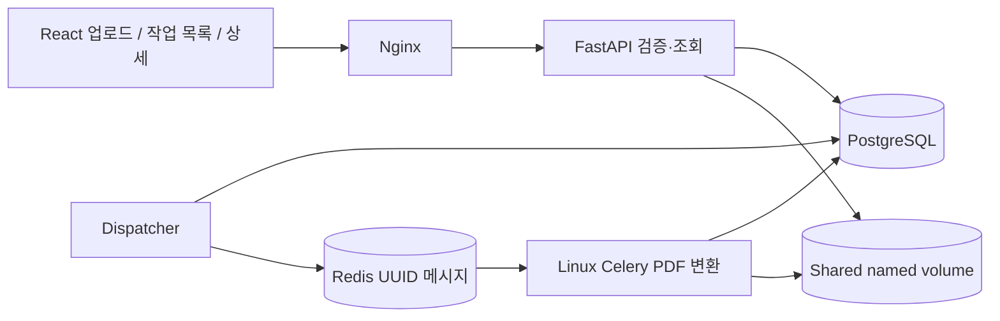
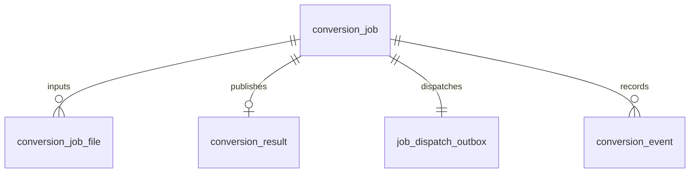

# 시스템 아키텍처 — Phase 2

## 파일 처리 흐름
1. 브라우저가 다중 파일의 순서와 검증된 형식의 options JSON을 multipart로 전송한다.
2. API가 UUID 경로에 저장하면서 개별/전체 크기를 제한하고, 모든 프레임을 디코딩해 실제 포맷·MIME·픽셀·페이지 제한을 확인한다.
3. Job, JobFile(0 기반 sort_order), Outbox, QUEUED 이벤트를 같은 DB 트랜잭션으로 저장한다. 하나라도 실패하면 이번 업로드 파일을 정리한다.
4. Dispatcher는 미발행 Outbox를 잠그고 UUID만 Redis에 발행한다. 발행 후 DB commit 실패에 따른 중복 전달을 허용한다.
5. Worker는 QUEUED→PROCESSING 조건부 Claim에 성공한 경우만 실행한다. 원본 해시와 페이지 정보를 다시 검증한다.
6. 파일 순서대로 TIFF 프레임을 확장한다. EXIF 방향·alpha 합성 후 Pillow PDF 페이지를 인코딩하고 pypdf로 크기·여백·fit을 적용한다. 디코딩한 전체 이미지 목록을 메모리에 쌓지 않는다. 인코딩된 PDF 객체는 Writer가 보관하므로 완전한 streaming 변환은 아니다.
7. 페이지 완료마다 Job 진행률과 PAGE_PROCESSED 이벤트를 한 트랜잭션으로 기록한다. 최종 페이지 수·PDF 파싱 검증 후 결과를 원자 이동한다.
8. Job row lock을 유지하며 Result(고유 job_id), SUCCESS 상태, 완료 이벤트를 같은 트랜잭션으로 확정한다. 실패 시 현재 진행 수를 남기고 FAILED 이벤트를 추가하며 부분 PDF를 다운로드하지 않는다.
9. UI는 상세·이벤트를 polling하고 종료 상태에서 멈춘다. 목록은 표시 중 주기적으로 조회한다. 다운로드 시 권한·SUCCESS·결과 크기·해시를 검사한다.

## DB ERD

Job: UUID, workspace/access 해시, 상태, 단계, options JSON, 전체/완료 파일·페이지 수, UTC 시간, 오류 코드·메시지.
JobFile: UUID, FK, 파일명, UUID 저장 경로, 크기·MIME·페이지·SHA256, sort_order. (job_id,sort_order) 고유 제약.
Result: UUID, 고유 Job FK, 경로·크기·SHA256·페이지 수·UTC 시간.
Event: UUID, Job FK, (job_id,sequence) 고유 제약, 타입·메시지·JSON details·UTC 시간. Job 갱신 lock 안에서 sequence를 부여하며 이력은 append-only다.
Job의 workspace_hash+created_at 복합 인덱스와 상태/각 FK 조회 인덱스를 사용한다. 구형 Job 입력·출력 컬럼은 호환성을 위해 유지하되 신규 파일/결과의 기준은 분리 테이블이다.

0002는 구형 단일 파일과 성공 결과를 backfill한다. 구형 오류를 그대로 보존하며 단계별 과거 이벤트를 만들어내지 않는다. LEGACY_IMPORTED 스냅샷만 추가한다. 데이터 유실이 생기는 downgrade는 차단했다.

## 상태와 진행률
현재 상태: QUEUED → PROCESSING → SUCCESS | FAILED. UPLOADING은 프런트 전용이다.
단계: QUEUED(0), INPUT_VALIDATION(10), PAGE_PROCESSING(10+floor(75×완료 페이지/전체 페이지)), RESULT_VALIDATION(95), SUCCESS(100). 전체 파일 수와 페이지 수를 별도로 추적한다. 성공 결과가 검증·게시·DB 확정되기 전에는 100을 기록하지 않는다.

## 권한 경계
신규 작업은 무작위 작업공간 capability 쿠키의 해시로 소유 범위를 제한한다. 목록은 해당 cookie 소유 작업만, 상세·이벤트·다운로드는 소유 cookie 또는 개별 Job 토큰을 확인한다. 기존 소유자를 모르는 Phase 1 작업은 목록에 자동 편입하지 않는다. 로컬 단일 사용자 MVP이며 계정 인증·다중 테넌트 서비스가 아니다.

## 중복 처리와 한계
원자적 Claim이 중복 Worker 진입을 막고 Result Job 고유 제약이 중복 레코드를 방지한다. 완료 이벤트는 SUCCESS 확정과 함께 생성한다. 현재 상태를 되돌리는 API가 없으므로 실패·완료 이력을 덮어쓰지 않는다. Lease 만료·Worker 재획득·fencing은 아직 없다. PROCESSING 중 Worker가 죽으면 자동 복구하지 않는다. DB와 파일 이동 사이 원자성도 없으며 orphan 결과 정리·강제 종료 테스트는 Phase 4다.

공유 저장소는 uploads/{job}/UUID, processing/{job}/{execution UUID}/output.pdf, results/{job}/result.pdf 구조다. 실행별 임시 경로와 전체 결과 검증을 유지한다. 자동 만료·용량 정리는 미구현이다. Redis/DB/Worker 모니터링 수치를 임의로 만들지 않는다.
